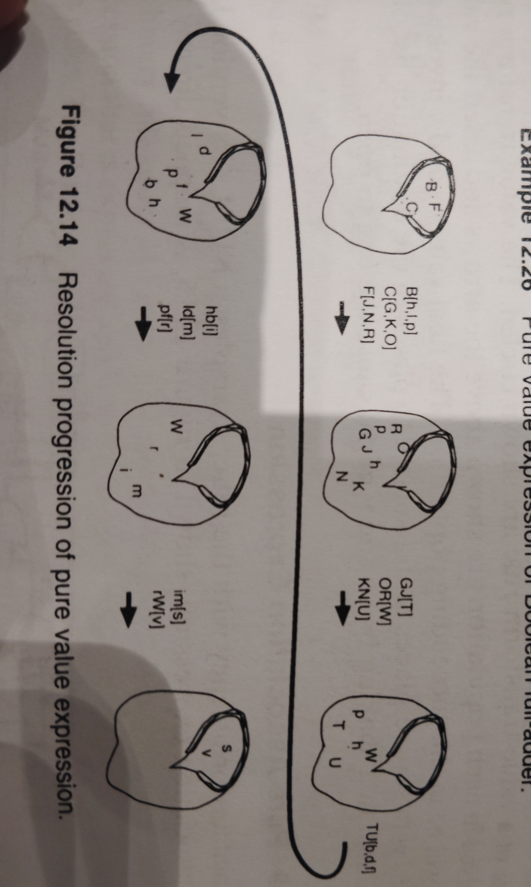

<!-- generated by weave from Linear issue TAG-63 — do not hand-edit -->

### TAG-63: 12.8.7 Pure Value Expression

**Status:** ⬜ Not started  |  📝 Needs content

## Software Notes

Here is how the boundary *actually* works based on the book:

1. **The bag is flat.** It just has `tokens` (the multiset) and `emitted` (the total count of everything ever produced).
2. **The rules are the mapping.** `S,U,W[K,M]` means firing this rule consumes `S,U,W` and produces `K,M`.
3. **The caller defines the interface.** The caller provided bindings: "I am feeding `[A, B, CI]` and I expect to read `[SUM, CO]`."
4. **To extract, we look at the rules.** If the caller expects `SUM`, and the callee's rules say that `K` and `L` are the only things that assert `SUM` (because of the `K[SUM<K>]` row), then the caller checks the bag for `K` or `L`. Whichever is present *is* the value of `SUM`.

So, extraction is not a lookup in a bag-specific destination map. Extraction is: **"For each expected destination port, look at what token the rules say belongs to that port, and check if that token is in the bag."**

## **Conclusion**

The fix isn't just about `inlineInvocation`. It's about **how rules for** `@runtime(consumable)` definitions are built. A fill like `K[SUM<K>]` must be translated into a different rule action than a pure value rule like `S,U,W[K,M]`.

In the bag model:

* A pure value rule `S,U,W[K,M]` becomes: `inputs=[S,U,W], action = .assert_tokens([K, M])` (adds to bag).
* A fill rule `K[SUM<K>]` becomes: `inputs=[K], dest=SUM, action = .assign_boundary(K)` (marks `SUM` as resolved to `K`, doesn't add to bag).

This is exactly what `bag.zig`'s `shake` needs to handle: `.assert_tokens` adds to bag, `.assign_boundary` records the emission and *doesn't* add the token to the bag.

Then extraction is trivial: after `shake`, look at the recorded boundary assignments and assert them on the caller's wires.

This perfectly matches the book: "The final values s and v invoke definitions with source places that associate to places in the destination list of the definition."

## **How to implement this**

1. `RuleAction` for consumable definitions. Add a new variant: `.boundary_assign: []const u8` (the token) with `dest = <the destination wire>`. The existing `.assert_symbol` remains for free values inside the bag.
2. `rules.zig buildRulesAtDepth`: when building rules for a consumable definition, detect fill-shaped contained rows (`K[SUM<K>]`) and emit `.boundary_assign` instead of `.assert_symbol`. (For non-consumable definitions, keep `.assert_symbol` because it's an environment assignment).
3. `bag.zig shake`: handle `.boundary_assign` by recording `dest -> token` in a `boundary_assignments` map, *without* adding the token to `tokens`.
4. `rules.run` `.consumable_call`: after `shake`, read `boundary_assignments` and assert them on the caller's wires.

This is clean, matches the book, and eliminates the infinite loop risk.

## Reference

In the expression of Example 12.24 the place of resolution contains no parentheses,so it is a pure value expression in which the values spontaneously asociate to form names of value tranform rules. The expression is entirely in terms of definitions. There is no association structure in the place of resolution. However, the values S, T, W, and X are used for both the input and for the output. To avoid reforming input names in the place of resolution, the result values must be isolated within a source place when they are delivered to the place of resolution. While the place of resolution of Example 12.24 is a pure value expression, the expression as a whole is not quite a pure value expression.

The values K, L, M, and N are added as output values that are unique from the input values.

S means A = 0

T means A = 1

U means B = 0

V means B = 1

W means CI = 0

X means CI = 1

K means SUM = 0

L means SUM = 1

M means CO = 0

N means CO = 1

The output values can now be delivered to the place of resolution as free values and can effect their own output, in this case by invoking a definition that contains a source place with themselves as content that associates to RSUM and RCARRY. The expression of Example 12.25, as a whole, is a pure value expression.

12.8.8 Another Pure Value Expression   The binary full-adder of Figure 12.7 can be mapped directly into a pure value expression that is expressed solely in terms of unique symbols and value transform rules. The Boolean logic expression uses two unique symbols, 0 and 1, and unique places within the expression to represent unique differentnesses within the expression. The 0 or 1 on this path is different from the 0 or 1 on that path. The graphical circuit in Figure 12.12 shows the mapping of each wire (association path) to two unique symbols. One representing a 0 symbol on the wire and one representing a 1 symbol on the wire.   C means $X = 0$   D means $X = 1$   E means $Y = 0$   F means $Y = 1$, and so on, for each wire in the circuit   The value transform rules for resolving each formed name are derived from the symbols associated with each function. The derivation of the value transform rules for the function surrounded by O, P, Q, R, W, and X is shown in Figure 12.13. The set of derived value transform rules then becomes the set of contained definitions. Example 12.26 is the pure value expression. The input content is dumped into the place of resolution with no invocation syntax and begins forming names.   Figure 12.14 shows the resolution for input values B, C, and F as a progression of populations of symbols in a shaking bag, which represents the place of resolution. In each population of values only certain associations form a name of a value transform rule. In each population the values that form the name of a value transform rule are shown circled. The value transform rules involved in each population are shown above the arrows and assert the values that will be in the succeeding population. The final values s and v invoke definitions with source places that associate to places in the destination list of the definition. In a shaking bag s and v might cause the bag to open.
