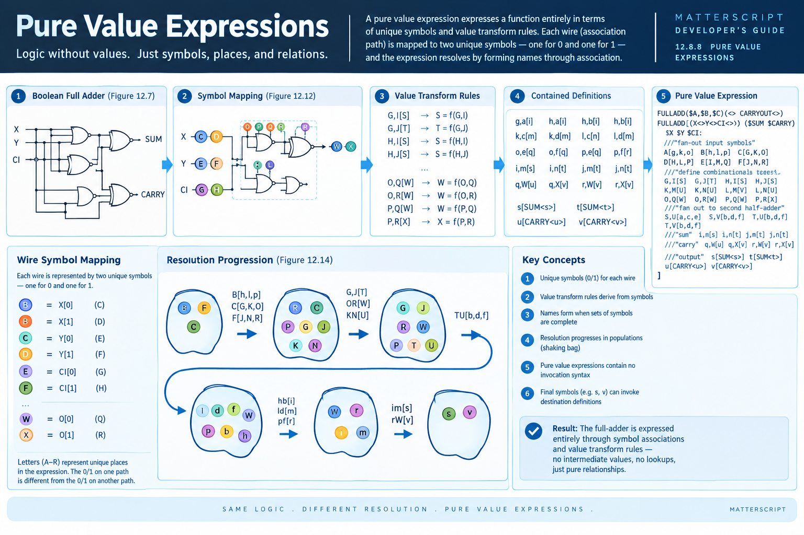

# Pure Value Expressions



A **pure value expression** is a MatterScript definition in which computation is expressed entirely through **unique symbols, places, associations, and value transform rules**. There is no conventional sequence of operations and no requirement that an intermediate value be explicitly stored or passed from one operation to another.

The Boolean full-adder is a useful example because the same logic can be represented several ways, including as a `@runtime(consumable)` definition whose place of resolution behaves as a **shaking bag**.

> **Same logic. Different resolution.**
> A pure value expression does not execute a sequence of Boolean operations. It establishes a space of possible associations and allows the arriving symbols to resolve the expression.

---

## From Circuit to Expression

Consider the binary full-adder. Its inputs are:

* `X`
* `Y`
* `CI` — carry in

and its outputs are:

* `SUM`
* `CARRY`

A conventional circuit describes this in terms of gates and wires. MatterScript can instead map every association path in that circuit to a collection of unique symbols:

```text
C means X = 0
D means X = 1

E means Y = 0
F means Y = 1

G means CI = 0
H means CI = 1
```

The important point is that the symbols are **unique to their places**. The `0` associated with one path is not the same global `0` as every other occurrence of zero; it represents the particular condition associated with that particular place in the expression. Thus:

```text
C ≠ E
D ≠ F
```

even though both pairs may represent the same logical values. This distinction allows the topology of the computation to remain encoded in the names themselves.

---

## Value Transform Rules as Resolution Points

Once symbols have been distributed through the expression, combinations of symbols begin to form names. For example:

```text
G,I[S]
G,J[T]
H,I[S]
H,J[S]
```

A pair of symbols `G + I` forms the name `GI`, and the association `GI[S]` states that the resulting relationship resolves toward `S`.

The process continues through the network. A few stages from the full-adder:

```text
K,M[U]
K,N[U]
L,M[V]
L,N[U]

O,Q[W]
O,R[W]
P,Q[W]
P,R[X]
```

The resulting expression is not a list of instructions. It establishes a set of **possible relationships**. When the appropriate symbols coexist at a resolution place, the corresponding name becomes complete and its association becomes available.

---

## The Shaking-Bag Model

A definition annotated with `@runtime(consumable)` is executed as a **shaking bag**: the place of resolution is a multiset of token names, and rules consume input tokens and produce output tokens until the bag reaches a fixed point.

For a `@runtime(consumable)` definition, each contained row is a rule. A row's left-hand side names the tokens it requires; its right-hand side names what it produces.

```text
S,U,W[K,M]
```

means: *when `S`, `U`, and `W` are present in the bag, consume one of each and add `K` and `M` to the bag.*

A row shaped as a destination fill

```text
K[SUM<K>]
```

means: *when `K` is present, consume it and record that the destination `SUM` resolves to `K`.* The destination symbol is *not* added back to the bag; it leaves the place of resolution and becomes a boundary assignment visible to the caller.

This distinction — **free-value reactions** versus **boundary assignments** — is the load-bearing one. Conflating them (treating `K[SUM<K>]` as "produce `K`") makes a bag that already contains `K` loop forever, because the rule that consumes `K` produces `K` again. The MatterScript runtime keeps the two apart:

| Row form | Runtime action | Effect |
|---|---|---|
| `S,U,W[K,M]` | `react` | consume `S,U,W`; add `K,M` to the bag |
| `K[SUM<K>]` | `assign` | consume `K`; record `SUM → K`; do not add to the bag |

### Rule ordering matters

Rules are tried in the order they appear. A react rule that consumes a token must be listed **before** an assign rule that would otherwise consume the same token as a boundary value. In the full-adder, the carry-chain react rules (`S,U,M`, `S,U,N`, etc.) must precede the boundary fills (`M[CO<M>]`, `N[CO<N>]`) — otherwise the fill rule consumes the incoming carry token before the react rule can use it, and the sum for that bit never resolves.

### Resolution progression

```text
Input population
      │
      │  react rules fire
      ▼
New population
      │
      │  more rules fire
      ▼
New population
      │
      │  no rule can fire
      ▼
Fixed point: boundary assignments are visible to the caller
```

The bag stops when a full pass produces no change. Any destination with a recorded boundary assignment is extracted to the caller; any destination without one is left unresolved, and the caller's completeness check reports it as stuck. Missing outputs are a normal outcome of the model, not an error.

---

## From the First Half-Adder to the Second

The first portion of the full-adder resolves into the intermediate symbols:

```text
S  T  U  V  W  X
```

These symbols become the input population for the next stage:

```text
S,U[a,c,e]
S,V[b,d,f]
T,U[b,d,f]
T,V[b,d,f]
```

Again, these are associations rather than assignments. The result of one resolution stage becomes the population from which the next set of names can form. The subsequent stages continue the process:

```text
g,a[i]  g,b[j]  h,a[i]  h,b[i]
k,c[m]  k,d[m]  l,c[n]  l,d[m]
o,e[q]  o,f[q]  p,e[q]  p,f[r]
```

and finally:

```text
i,m[s]  i,n[t]  j,m[t]  j,n[t]
q,W[u]  q,X[v]  r,W[v]  r,X[v]
```

The entire Boolean full-adder has therefore been transformed into a network of symbolic associations.

---

## The Pure Value Expression

The complete MatterScript expression, with `@runtime(consumable)` to select the shaking-bag execution model:

```matterscript
FULLADD($A,$B,$C)(SUM<> CARRYOUT<>)

FULLADD[(X<>Y<>CI<>)( $SUM $CARRY)
  @runtime(consumable)
  $X $Y $CI :

  // "fan-out input symbols"
  A[g,k,o]
  B[h,l,p]
  C[G,K,O]
  D[H,L,P]
  E[I,M,Q]
  F[J,N,R]

  // "define combinational resolution stages"
  G,I[S]
  G,J[T]
  H,I[S]
  H,J[S]

  K,M[U]
  K,N[U]
  L,M[V]
  L,N[U]

  O,Q[W]
  O,R[W]
  P,Q[W]
  P,R[X]

  // "fan out input to second half-adder"
  S,U[a,c,e]
  S,V[b,d,f]
  T,U[b,d,f]
  T,V[b,d,f]

  g,a[i]
  g,b[j]
  h,a[i]
  h,b[i]

  k,c[m]
  k,d[m]
  l,c[n]
  l,d[m]

  o,e[q]
  o,f[q]
  p,e[q]
  p,f[r]

  // "sum"
  i,m[s]
  i,n[t]
  j,m[t]
  j,n[t]

  // "carry"
  q,W[u]
  q,X[v]
  r,W[v]
  r,X[v]

  // "output"
  s[SUM<s>]
  t[SUM<t>]
  u[CARRY<u>]
  v[CARRY<v>]
]
```

Notice what is absent. There is no expression such as `SUM = X XOR Y XOR CI`. There is no procedural sequence `a = ...; b = ...`. There are no explicit intermediate Boolean values. The program describes **which symbols can associate with which other symbols**.

---

## No Invocation Is Required

A conventional invocation might explicitly name a computational operation:

```text
some_gate(input1, input2)
```

A pure value expression does not require that form. The input content is simply introduced into the place of resolution:

```text
$X $Y $CI:
```

From there, the content begins forming names through the associations defined in the expression. The expression is closer to a **declarative topology of possible resolution** than to an imperative program. The computational behavior emerges from the relationships.

---

## Final Symbols Become Output Associations

At the end of the resolution process, the surviving symbols are `s`, `t`, `u`, `v`. These are associated with the external result places:

```text
s[SUM<s>]    t[SUM<t>]
u[CARRY<u>]  v[CARRY<v>]
```

The `<...>` notation identifies the destination place and the corresponding content. In the shaking-bag model, these are the **boundary assignments** the runtime extracts after the bag settles: the appropriate destination association has become complete, and the resulting content propagates outward.

Conceptually:

```text
             ┌── SUM
s ───────────┤
t ───────────┘

             ┌── CARRY
u ───────────┤
v ───────────┘
```

---

## Consumable Definitions Are Leaves

A `@runtime(consumable)` definition executes in its own bag. That bag **does not leak** to the caller, and a consumable definition cannot itself invoke another definition:

* The bag's token namespace is entirely internal to the definition.
* Invoking a consumable definition from a non-consumable caller crosses a boundary: the caller seeds the bag from its input wire values, shakes to a fixed point, and extracts the resulting boundary assignments back onto its output wires.
* Composing a consumable definition with other logic is done **at the caller**: invoke the consumable leaf and the other definitions side by side, and feed the leaf what it needs.

This is enforced by validation: a `@runtime(consumable)` definition that contains an `.invoke` statement is rejected at parse time (`ConsumableDefinitionContainsInvocation`). The constraint keeps the runtime model simple: bags are bounded, bags don't nest, and the boundary between bag semantics and persistent-signal semantics is crossed in exactly one place.

---

## Symbol Namespaces and the "Input == Output" Problem

A consequence of the bag model is that **input symbols and output symbols must be distinguishable**, even when they encode the same logical condition. In the full-adder above:

* `X = 0` is `C`; `X = 1` is `D`.
* `SUM = 0` is `s`; `SUM = 1` is `t`.

These are distinct symbols even though `C` and `s` both "mean 0" in the abstract. If the input and output vocabularies shared names, an input `K` and an output `K` could collide inside the bag — a `K[SUM<K>]` rule intended to fire on a *produced* `K` would also fire on a *seeded* `K`, and the destination would resolve ambiguously.

The book's phrasing captures this: *"the result values must be isolated within a source place when they are delivered to the place of resolution."* In MatterScript practice:

* Use a dedicated vocabulary for each definition's inputs.
* Use a dedicated vocabulary for its outputs.
* When chaining consumable definitions (e.g. a carry from one bit-slice to the next), the receiving definition must include rules for **the previous definition's output symbols**, not just its own fresh-input symbols.

A 4-bit adder built from four full-adder slices demonstrates this: the rule table for a full-adder slice must include both `S,U,W[K,M]` (fresh carry-in of 0) and `S,U,M[K,M]` (carry-in from the previous slice). The two rules produce the same output, but they match on different carry-in symbols. Without the second, multi-bit chaining stalls after the first bit.

---

## Pure Values Versus Value Transforms

It is useful to distinguish two ways an expression can terminate.

### Value-transform resolution

A formed name identifies a value transform rule:

```text
symbols  →  formed name  →  value transform  →  value
```

This is the model used by the earlier full-adder example (TAG-129) and by most of the non-consumable corpus.

### Pure association resolution

A formed name identifies an association:

```text
symbols  →  formed name  →  association  →  new symbol/place
```

The second form does not require the computation to terminate in a conventional stored value. A `@runtime(consumable)` definition is executed as the second form: the bag holds symbols, rules consume and produce symbols, and the boundary assignments at the end are the surviving relations that reach a destination place.

**The same logical function can be represented either way.** A Boolean full-adder can be expressed using explicit value transforms (TAG-129's `FULLADD129`), or as a network of primitive symbolic relationships (TAG-211's `FULLADD4BIT`). Both are valid; they differ in which execution model applies and how the caller composes them.

---

## Why This Matters for MatterScript

Pure value expressions demonstrate an important property of the MatterScript model:

> **Computation does not have to be represented as the transformation of values. It can be represented as the formation and propagation of relationships.**

Once computation is expressed in this form, several familiar distinctions begin to collapse. The boundary between data and connectivity, value and identity, computation and wiring, expression and topology, software and hardware becomes much less rigid. The expression already contains the connectivity information that a hardware implementation requires.

For example, `A[g,k,o]` is simultaneously:

1. a symbolic relationship,
2. a fan-out description,
3. a piece of computational topology, and
4. a potential hardware wiring relationship.

The MatterScript compiler can therefore lower the same semantic structure into different physical representations without requiring the programmer to rewrite the computation as a conventional hardware description.

---

## Pure Value Expressions and Physical Computation

This is particularly significant for asynchronous and spatial computation. A conventional program generally describes **what operation happens next**; a pure value expression describes **what relationships are possible where**. That distinction becomes increasingly useful as computation moves toward asynchronous logic, NULL Convention Logic, spatially distributed computation, FPGA fabrics, hardware synthesis, sensor networks, edge computation, and physically embedded computation.

In these systems, locality and connectivity are not merely implementation details. They are part of the computational structure. Pure value expressions provide a language-level mechanism for expressing that structure directly.

---

## Reading a Pure Value Expression

When reading a pure value expression, resist the temptation to read it as a sequence of assignments. Instead, read it as a **field of possible associations**:

```text
             symbols arrive
                    │
                    ▼
          ┌──────────────────┐
          │ place of         │
          │ resolution (bag) │
          │                  │
          │   B  F  C        │
          │      G  J        │
          │   P       K      │
          └──────────────────┘
                    │
             names become
               complete
                    │
                    ▼
             new associations
                    │
                    ▼
          next population
                    │
             no rule fires
                    │
                    ▼
          boundary assignments
             (the outputs)
```

The expression is not telling the runtime to *execute* each line. It is defining the relationships that allow symbols to propagate and form complete names.

That is why the full-adder can be described without an explicit chain of Boolean operations.

---

## Summary

A pure value expression:

* represents computation through **unique symbols and associations**;
* assigns distinct symbols to the distinct paths of a computation;
* allows symbols to propagate through **name correspondence**;
* forms names when the required symbols coexist;
* can be executed either as a **value-transform network** (persistent-signal semantics) or as a **shaking bag** (`@runtime(consumable)`);
* in the bag model, distinguishes **free-value reactions** (add tokens to the bag) from **boundary assignments** (record a destination's resolved symbol without adding it to the bag), and **orders rules** so react rules precede fill rules when the same token could be consumed by either;
* progresses through populations of symbols rather than a procedural instruction sequence;
* can express fan-out directly through constructs such as `A[g,k,o]`;
* can terminate in destination associations such as `s[SUM<s>]`;
* preserves the topology of the computation as part of the expression itself; and
* in the consumable model, **does not leak its bag to the caller** — composition happens at the caller, which seeds the bag from its input wires and extracts the resulting boundary assignments back onto its output wires.

The Boolean full-adder demonstrates the central idea:

> **The logic does not need to be described as a sequence of value transformations. The relationships that make the logic possible can themselves constitute the expression.**

This is one of the steps by which MatterScript moves from describing **what a computation calculates** toward describing **where computation exists, what can associate with what, and how information propagates through physical structure**.