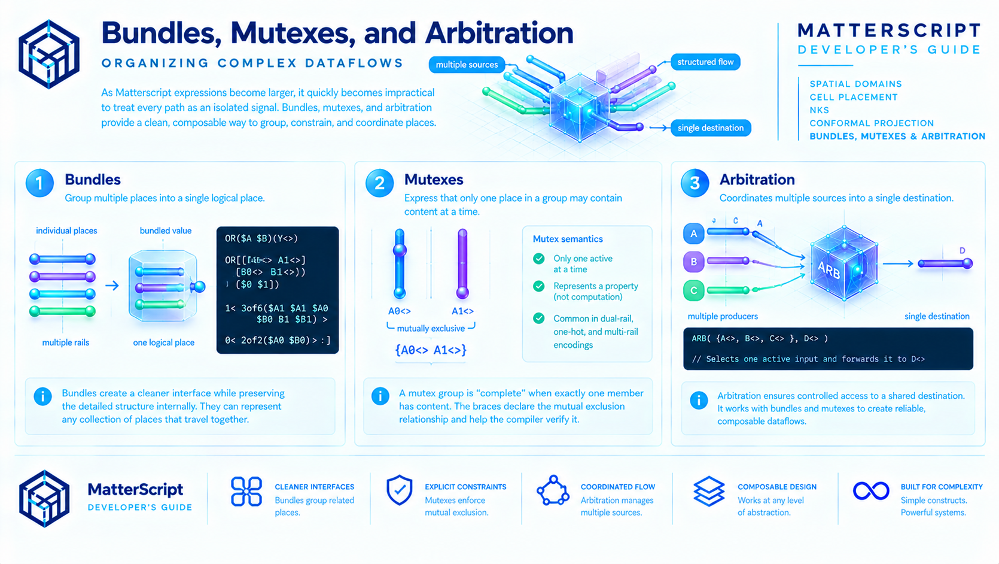

## Bundles, Mutexes, and Arbitration



As Matterscript expressions become larger, it quickly becomes impractical to treat every path as an isolated signal. A single value may be represented by multiple rails, a bus may consist of dozens of paths, and multiple producers may need to communicate through a shared destination. Matterscript provides three closely related mechanisms to address these common patterns:

- **Bundles** group multiple places into a single logical place.
- **Mutexes** express that only one place in a group may contain content at a time.
- **Arbitration** coordinates the flow of multiple independent sources into a single destination.

Together, these constructs allow complex dataflows to be expressed without sacrificing the explicit association model that lies at the heart of the language.

### Bundles

A bundle is a named collection of places that travel together as a single logical unit. Rather than enumerating every constituent place by hand, a bundle declares its **base name**, its **direction**, and its **range**, and the compiler expands the range into indexed members.

```matterscript
ADDER4($A $B $CIN)(SUM0<> SUM1<> SUM2<> SUM3<> COUT<>)
ADDER4[([A<> 0..3] [B<> 0..3] CIN<>)
  (SUM0<> SUM1<> SUM2<> SUM3<> COUT<>)
  // Four full-adder instances, chained by carry.
  FULLADD($A.0 $B.0 $CIN)(SUM0<> C1<>)
  FULLADD($A.1 $B.1 $C1)(SUM1<> C2<>)
  FULLADD($A.2 $B.2 $C2)(SUM2<> C3<>)
  FULLADD($A.3 $B.3 $C3)(SUM3<> COUT<>)
  :
]
```

The definition's source list contains two bundle declarations, `[A<> 0..3]` and `[B<> 0..3]`, plus a plain place `CIN<>`. Each bundle declaration is one top-level source entry. It expands internally into four members:

```
A.0  A.1  A.2  A.3
B.0  B.1  B.2  B.3
```

The dot notation `A.0` is the **member reference**: base name `A`, member index `0`. Member references are ordinary place names in every other respect — they can appear anywhere a place name can, including in the source and destination arguments of an invocation.

#### Bundle declarations

A bundle declaration has three parts:

```
'[' name direction range ']'
```

- **name** — the base name of the bundle, e.g. `A`.
- **direction** — `<>` for a source (content flows *in* to the definition), `$name` for a destination (content flows *out*). The direction must match the position: source-list bundles use `<>`, destination-list bundles use `$`.
- **range** — `low..high`, inclusive on both ends, e.g. `0..3`.

The declaration expands into members `name.low`, `name.low+1`, …, `name.high`. So `[A<> 0..3]` expands to `A.0`, `A.1`, `A.2`, `A.3` as source places.

#### Direction

The direction marker distinguishes source bundles from destination bundles:

```matterscript
// A bundle of four source places, expanded to A0 .. A3
[A<> 0..3]

// A bundle of four destination places, expanded to $SUM.0 .. $SUM.3
[$SUM 0..3]
```

Source bundles use `<>`; destination bundles use `$` before the base name (matching the `$name` convention for single destination places elsewhere in the language).

#### Arity

The number of top-level entries in the invocation's source list must equal the number of top-level entries in the definition's source list. Bundle declarations count as **one** entry each, regardless of how many members they expand to.

In the `ADDER4` example above:

- Invocation: `($A $B $CIN)` — three top-level sources.
- Definition: `([A<> 0..3] [B<> 0..3] CIN<>)` — three top-level sources.

The correspondence is 1-to-1: `$A` binds to `[A<> 0..3]`, `$B` binds to `[B<> 0..3]`, and `$CIN` binds to `CIN<>`. Inside the definition, the expanded members are available as `A.0 .. A.3` and `B.0 .. B.3`; the invocation does not need to know the range.

#### Member references

A member reference is a place name written `base.index`, where `base` is the bundle's declared name and `index` is a member index in the bundle's range. Member references appear in three places:

- In the bodies of nested invocations:
  ```matterscript
  FULLADD($A.0 $B.0 $CIN)(SUM0<> C1<>)
  FULLADD($A.1 $B.1 $C1)(SUM1<> C2<>)
  ```
- In the definition's own resolution and contained rules.
- In any expression where a place name is expected.

Member references are **canonical**: `A.0` is the name of the place, and it is what the compiler emits as the port and signal name in hardware. There is no separate aliasing step.

#### Where bundle member names live

When a bundle is declared `[A<> 0..3]`, the names `A.0`, `A.1`, `A.2`, `A.3` come from the declaration itself — they are the physical members the compiler emits for the definition's interface. The invocation's `$A` is a *label* for the association, not a name in the physical interface; the invocation-side name never appears as a port.

When the compiler emits a top-level network entity for the definition above, the entity's input ports are named after the bundle members: `A.0`, `A.1`, `A.2`, `A.3`, `B.0`, `B.1`, `B.2`, `B.3`, and `CIN`. The invocation's `$A` and `$B` do not appear in the port list.

#### A note on the older group syntax

Earlier versions of the language wrote bundle members out explicitly as a bracketed group of individual places, e.g. `[{A0<> A1<>}]`. That form is **replaced** by the range form: `[A<> 0..3]` means the same thing as `[{A.0<> A.1<> A.2<> A.3<>}]`, but the range form states the pattern and lets the compiler expand it. Where both are accepted, prefer the range form — it scales to large buses without repeating the base name.

#### Bundles as structure

Conceptually, bundling is similar to a structure or record in conventional programming languages, except that the bundle represents **paths of association** rather than fields of memory. A bundle's members are accessed positionally via their index (`A.0`, `A.1`, …) rather than by a named field.

Bundles are not limited to dual-rail logic or buses. They can represent any collection of places that naturally travel together.

#### Nested bundles

A bundle member is itself a place, so bundles can be nested. This is expressed with member references into nested indices:

```matterscript
[[A<> 0..1] [B<> 0..1]]
```

Here the outer bundle has two members; each is itself a bundle of two members. In the definition body the individual places are `A.0.0`, `A.0.1`, `A.1.0`, `A.1.1`, and so on, following the member-reference rule recursively.

<!-- TODO: verify the exact notation for nested bundle declarations and
     member references with more than one level of nesting. The expansion
     rule (name.low .. name.high at each level) is clear; the surface
     syntax for declaring the inner ranges may need adjustment. -->

Because bundling follows the natural hierarchy of composition, large interfaces remain compact while definitions retain complete visibility of their internal structure.

### Mutual Exclusion (Mutex)

Many bundled representations describe values for which only one member may ever be active.

Dual-rail logic is the simplest example. If a Boolean value is represented by two rails:

```matterscript
A0<>
A1<>
```

then only one rail may contain content at any instant. The rails are therefore enclosed in braces:

```matterscript
{A0<> A1<>}
```

The braces declare a **mutual exclusion relationship**. Rather than describing computation, the mutex expresses a property of the representation itself: these places are alternative encodings of the same logical value, and content appearing in more than one of them would be a contradiction.

Mutexes appear naturally throughout Matterscript: dual-rail values, multi-rail encodings, one-hot state machines, alternative symbolic representations. They communicate intent while allowing the compiler to verify that mutually exclusive paths remain mutually exclusive throughout the design.

Note that mutex brackets are **not** interchangeable with bundle brackets. A bundle says "all members together"; a mutex says "exactly one member." Using the wrong one describes a different representation, and the emitted hardware follows.

#### Mutex and completeness

A mutex group participates in completeness differently than a bundle does.

A bundle's completeness is the conjunction of its members: the group is complete when *every* member has content.

A mutex group's completeness is the disjunction of its members: the group is complete when *at least one* member has content, and the mutual exclusion property guarantees that at most one does. "Complete" for a mutex therefore means "exactly one member has content."

This distinction matters for source and destination lists. Consider a definition whose source list contains two mutex groups:

```matterscript
OR[({A0<> A1<>}{B0<> B1<>})({$0 $1})
  :
  A0,B0[0]
  A0,B1[1]
  A1,B0[1]
  A1,B1[1]
]
```

(Example 12.9, *Mutually exclusive completeness*.)

The source list `({A0<> A1<>}{B0<> B1<>})` names two mutex groups. The definition is *complete* when the first group has exactly one of `A0`/`A1`, and the second group has exactly one of `B0`/`B1`. No other combination counts as complete — an empty group means the source is still waiting for content.

The destination list `({$0 $1})` is also a mutex group. The definition's output is a value on exactly one of `$0` or `$1`, never both. Which one is determined by the resolution rules.

Each rule reads a completeness pattern from the sources and asserts a value on the corresponding destination:

| Sources present | Destination |
|---|---|
| `A0`, `B0` | `0` |
| `A0`, `B1` | `1` |
| `A1`, `B0` | `1` |
| `A1`, `B1` | `1` |

The `0` and `1` in the rules are **tokens**, not destination names. Because the destination list is a mutex group of places named `$0` and `$1`, and the tokens asserted by the rules are `0` and `1`, the mutex acts as the routing mechanism: asserting token `0` means "activate `$0`", asserting token `1` means "activate `$1`". Only one rule fires per wavefront, so only one destination place receives content — exactly what the mutex declares.

#### Completeness by group kind

The kinds of group have different completeness conditions on sources and destinations:

| Group kind | Source completeness | Destination completeness |
|---|---|---|
| Bundle `[...]` (range form) | all members present | all members asserted |
| Mutex `{...}` | exactly one member present | exactly one member asserted |
| Arbitration `{{...}}` | at least one member present | (not a destination form) |

#### How mutexes affect emitted hardware

Mutually exclusive destinations are wired as mutually exclusive drivers. When the compiler emits VHDL for the example above, each destination place becomes an output signal driven by a conditional assignment:

```vhdl
ms_0 <= data_value(0) when (A0_valid = '1' and B0_valid = '1') else null_value;
ms_1 <= data_value(1) when (A0_valid = '1' and B1_valid = '1')
                       or (A1_valid = '1' and B0_valid = '1')
                       or (A1_valid = '1' and B1_valid = '1')
             else null_value;
```

Each destination's assignment falls back to `null_value` when its condition doesn't hold, so the two signals are never both driven in the same cycle. That is the mutex property, enforced structurally by the emitted code rather than by convention.

<!-- TODO: the current compiler emits the surrounding structure (signals,
     validity extraction, `complete`, port map) but does not yet lower
     token rules into conditional assignments like the ones shown here. -->

#### Design consequences

The mutex is not a notation for exclusive-or logic, and it is not a shorthand for a decoder. It is a statement about the *representation*.

Because it is a property of the representation rather than a computation, the mutex propagates through composition. A definition that consumes a mutex group and produces another mutex group has preserved the property end-to-end. Composing two such definitions preserves it again.

This is also why mutexes and bundles are not interchangeable: a bundle asserts "all members together," a mutex asserts "exactly one member." Using the wrong one describes a different representation.

### Arbitration

Mutual exclusion describes values. Arbitration describes **behavior**.

Consider two independent producers attempting to send content to the same destination. If both produce content simultaneously, which one should proceed first?

```matterscript
Arbiter({{$place1 $place2}})(next<>)

Arbiter[(placeB<>)(pass<>)
    pass<$placeB> :
]
```

The double braces in the invocation indicate that `$place1` and `$place2` are competing for access to the same flow path. If both places contain content simultaneously, the arbiter performs a competition; the winner proceeds through the expression, and the remaining content waits until the next opportunity.

Importantly, the language does **not** define which competitor wins. The result is intentionally nondeterministic.

If only one place contains content, no competition occurs and the content flows immediately. The effect is to transform multiple independent, uncoordinated flows into a single coordinated flow.

```text
place1  ─┐
         │
place2 ──┼──► Arbiter ───► next<>
         │
place3 ──┘
```

#### The `{{...}}` group is a single source

The double braces `{{...}}` denote a single arbitration group. Unlike nested bundles, which use `[[...] [...]]` to mean "a bundle of bundles," the doubled braces are one grouping construct: an arbitration group.

An arbitration group with two members counts as **one** source entry in the invocation's source list, not two. It participates in arity the same way a range bundle does: as a single top-level source that expands internally into its members.

#### Arbitration semantics

An arbitration group at a source means: content may arrive on any subset of the members, and the definition receives exactly one wavefront per accepted arrival. If two members arrive in the same wavefront, one is chosen nondeterministically and the other waits for the next cycle. The definition body sees one wavefront at a time, never both competitors simultaneously.

At the destination, the arbiter's output is a single stream of wavefronts, one per accepted source arrival. There is no merging of contents, no queueing at the destination, and no priority — just serialization.

The arbitration property lives at the invocation level. The definition that receives the arbitration group sees a flat single source and processes one wavefront at a time; it does not need to know how many competitors there are.

### A Hierarchy of Flow

Bundles, mutexes, and arbitration each solve a different problem.

Bundles organize related paths. Mutexes describe alternative representations of the same logical value. Arbitration coordinates independent flows that converge upon a common destination.

Although distinct, they frequently appear together. A bundled value may contain mutually exclusive rails. Multiple bundled values may compete through an arbiter. An arbiter may produce another bundled value for the next stage of computation.

These constructs allow Matterscript to scale naturally from individual signal paths to complex computational fabrics while preserving the same fundamental principle introduced throughout this guide:

**computation is expressed as the movement and transformation of associations rather than the execution of sequential instructions.**
