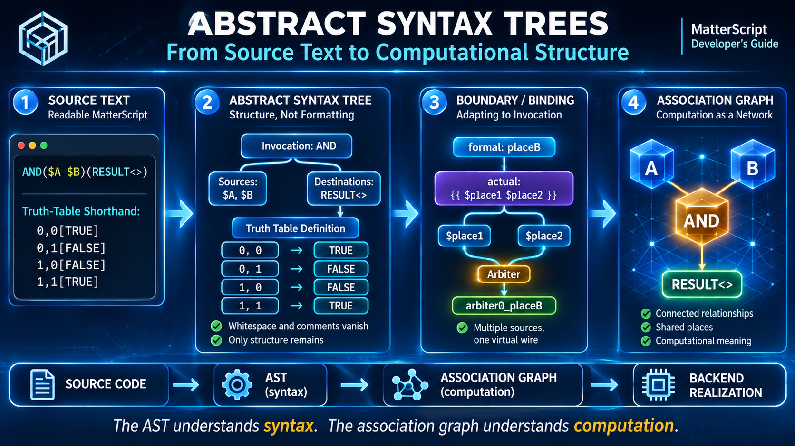

# Abstract Syntax Trees



Every MatterScript program begins life as text.

```matterscript
FULLADD($A $B $C)(SUM<> CARRY<>)
```

To a human, this is a readable description of a computation.

To a compiler, it is only a sequence of characters.

Before the compiler can reason about the program, it must recover its structure.

That structure is represented internally as an **Abstract Syntax Tree**, or AST.

---

## The Program Beneath the Text

An AST ignores formatting and punctuation that exist only to help humans read the language.

For example,

```matterscript
AND($A $B)(RESULT<>)
```

might be represented internally as something conceptually similar to

```text
Invocation
 ├── Name: AND
 ├── Source List        (caller-relative: what feeds the callee)
 │     ├── $A
 │     └── $B
 └── Destination List   (caller-relative: what the callee produces)
       └── RESULT<>
```

This tree captures the meaning of the program without preserving its exact textual representation.

Whitespace disappears.

Comments disappear.

Formatting disappears.

Only structure remains.

---

## The AST Is Not the Computation

One of the easiest mistakes to make when thinking about compilers is to imagine that the AST somehow *is* the program.

It isn't.

The AST is simply the compiler's understanding of the source text.

It exists only long enough for the compiler to analyze the language.

The computational model appears later.

```text
Source Code
        │
        ▼
Abstract Syntax Tree
        │
        ▼
Association Graph
        │
        ▼
Backend Realization
```

This distinction is important.

The AST understands syntax.

The association graph understands computation.

---

## Compiler AST

The abstract syntax tree (AST) for IPL/NPL dialects translates high-level component declarations, resolution blocks, and transition rules into structured intermediate representations.

Understanding how source text maps to internal Go/Zig structs (`network.Definition`, `Arg`, and `Place`) is essential for building custom evaluators, validators, and code generators.

---

### Shorthand Truth-Table Syntax

To streamline truth-table definitions and value transform rules, the parser supports a shorthand row notation. Instead of requiring a full nested component signature, shorthand rows specify input identifiers separated by commas, followed by bracketed output targets.

#### Example: Binary Equality Evaluation

```matterscript
binaryequal[(a<> b<>) 
   <$a$b()>
    : 0,0[TRUE]
      0,1[FALSE]
      1,0[FALSE]
      1,1[TRUE]  
]
```

---

### Internal AST Mapping

When the compiler encounters a shorthand truth-table row inside a `contained` section, it synthesizes a nested `Definition` object representing that transition row.

The table below illustrates how the components of a shorthand row map to internal `network.Definition` fields:

| Source Text Element | AST Field (`network.Definition`) | Internal Representation |
| --- | --- | --- |
| **Input Tuple** (`0,0`) | `.name` | Captured as the row's name string (e.g., `"0,0"`). |
| **Bracketed Target** (`[TRUE]`) | `.resolution` | A slice of `Statement` unions holding `SourceFill` structs (`.fill`), where `dest_name` is empty or implicit and `expr` captures the target value (`"TRUE"`). |
| **Sub-Components** | `.contained` | Empty (`&.{}`) for leaf truth-table rows, or nested `Definition` slices for hierarchical logic blocks. |

---

### Structural Breakdown

For the `binaryequal` example above, the resulting parent definition holds **four contained shorthand definitions** within its AST:

```rust
Definition{
    .name = "binaryequal",
    .sources = &.{
        Arg{ .kind = .place, .name = "a" },
        Arg{ .kind = .place, .name = "b" },
    },
    .destinations = &.{},
    .resolution = &.{},
    .contained = &.{
        Definition{
            .name = "0,0",
            .resolution = &.{
                Statement{ .fill = SourceFill{ .dest_name = "", .expr = "TRUE" } },
            },
        },
        Definition{
            .name = "0,1",
            .resolution = &.{
                Statement{ .fill = SourceFill{ .dest_name = "", .expr = "FALSE" } },
            },
        },
        Definition{
            .name = "1,0",
            .resolution = &.{
                Statement{ .fill = SourceFill{ .dest_name = "", .expr = "FALSE" } },
            },
        },
        Definition{
            .name = "1,1",
            .resolution = &.{
                Statement{ .fill = SourceFill{ .dest_name = "", .expr = "TRUE" } },
            },
        },
    },
}
```

## Parsing MatterScript Expressions: AST Generation Guide

This section details how MatterScript parses complex component definitions—such as gate-level logic or truth-table lookups—into the Abstract Syntax Tree (AST).

---

### Anatomy of the Expression

Consider the following MatterScript snippet representing a full adder definition with explicit truth-table mappings (`TAG-184`):

```matterscript
  // Linear: TAG-184 Pure Value Place of Resolution
      
      FULLADD($A,$B,$C)(<> CARRYOUT<>)
        
      FULLADD[(A<> B<> CI<> )($SUM $CO)
        
        $A$B$CI :
        
        S,U,W[SUM<S> CO<W>] 
        S,U,X[SUM<T> CO<W>]
        S,V,W[SUM<T> CO<W>] 
        S,V,X[SUM<S> CO<X>]
        T,U,W[SUM<T> CO<W>] 
        T,U,X[SUM<S> CO<X>]
        T,V,W[SUM<S> CO<X>] 
        T,V,X[SUM<T> CO<X>] 
      ]
```

When the parser encounters this structure, it translates the linear syntax into a hierarchical AST node structure.

---

### Step-by-Step AST Translation

* **Line Comment & Metadata:** The leading `//` acts as a metadata comment, attaching tags (e.g., `TAG-184`) to the enclosing expression node for diagnostic and resolution tracking.
* **Gate / Component Invocation:** `FULLADD($A,$B,$C)(<> CARRYOUT<>)` is parsed into an invocation node containing positional input arguments ($A, $B,$C) and output resolution placeholders (`CARRYOUT<>`).
* **Truth Table Mapping (`[...]`):** The bracketed block defines a truth-table or state-transition matrix. The parser maps input tuples ($A, $B,$CI) to output bindings ($SUM,$CO).
* **Resolution Rules:** Each line (e.g., `S,U,W[SUM<S> CO<W>]`) is parsed into individual evaluation clauses that feed directly into the `SourceFill` struct's `parsed_expr` field.

---

### Integration with `SourceFill`

In the compiler backend, when an unresolved invocation is detected within a fill statement, the raw string is parsed and stored using the following structure:

```rust
pub const SourceFill = struct {
    /// The destination place being filled (output of definition)
    dest_name: []const u8,
    /// The expression whose value fills the place
    expr: []const u8,
    /// Parsed expression when the fill contains an unresolved invocation.
    parsed_expr: ?*const Expr = null,
};
```

> **Note:** Ensure that any custom parser extensions handling transformation rules preserve the table row ordering, as downstream code generators rely on sequential pattern matching for hardware layout synthesis.

---

This unified AST representation allows evaluators to process truth-table rows uniformly alongside standard nested hardware blocks while eliminating boilerplate component naming in dense logic tables.

---

## Arbitration Groups

A **group** is an argument position holding several places rather than one. MatterScript has three group kinds, distinguished by their delimiter:

| Delimiter | Kind | Meaning |
|---|---|---|
| `[ ... ]` | `bundle` | All members are simultaneously present; the group as a whole carries a coherent multi-part value. |
| `{ ... }` | `mutex` | Exactly one member is present at a time; the group carries whichever member is active. |
| `{{...}}` | `arbitration` | Zero, one, or several members may be present; the runtime picks one to act as the group's single value. |

An arbitration group in a **source** (invocation-input) position expresses the book's arbitration semantics: *"If all the arbitrated places have content simultaneously, the places will compete for the privilege of flowing through the arbiter. It cannot be predetermined which content will flow."*

The syntax is:

```matterscript
Arbiter({{$place1 $place2}})(next<>)
```

Under the AST's source/destination convention (which is **callee-relative**: `Invocation.sources` holds what the callee receives, `Invocation.destinations` holds what the callee produces), the arbitration group is in the invocation's source list — that is, the caller is offering two candidate places to feed the callee's single input port.

### AST Shape

The parser produces:

```rust
Statement{ .invoke = Invocation{
    .name = "Arbiter",
    .sources = &.{
        Arg{
            .kind = .group,
            .group = &.PlaceGroup{
                .kind = .arbitration,
                .places = &.{
                    Arg{ .kind = .place, .name = "place1", .direction = .destination },
                    Arg{ .kind = .place, .name = "place2", .direction = .destination },
                },
            },
        },
    },
    .destinations = &.{
        Arg{ .kind = .place, .name = "next", .direction = .source },
    },
} }
```

Two things about this shape are load-bearing downstream:

- **`.group.kind == .arbitration`** distinguishes the group from a bundle or mutex. Only arbitration groups are collapsed to a single input value at the callee boundary; bundle and mutex groups bind member-wise.
- **Each member carries `.direction = .destination`** because `$placeN` is a reference form (the caller names wires that already exist in its scope). This is the same direction marker that `bindArgument` reads when partitioning source-side and destination-side bindings.

A parser test asserts exactly this shape, so a change to `parseGroup` or the direction-marker work that altered arbitration group parsing would fail loudly rather than silently breaking the runtime boundary.

---

### Formals and Actuals

Every invocation is a correspondence between two lists:

- The **formal** side is the callee's declared ports — the parameter names in the callee's definition header. For

  ```matterscript
  Arbiter[(placeB<>)($pass) ... ]
  ```

  the formals are `placeB` (source port) and `pass` (destination port).

- The **actual** side is what the caller wrote at the invocation site. For

  ```matterscript
  Arbiter({{$place1 $place2}})(next<>)
  ```

  the actuals are `{{$place1 $place2}}` (the arbitration group) and `next<>` (the destination wire).

Binding pairs formals with actuals **positionally**. Formal 0 (`placeB`) ↔ actual 0 (`{{$place1 $place2}}`); formal 1 (`pass`) ↔ actual 1 (`next<>`). Names on the two sides do not need to match. Position is what carries the correspondence across the boundary.

For an ordinary scalar actual, the binding is one formal to one caller wire, and the AST survives unchanged into the association graph — the callee's rules reference the formal, the binding's `caller` field names the actual wire, and the rule-rewriting pass (`mapName`) substitutes the actual name for the formal wherever the callee's body mentions the formal.

For an **arbitration actual**, the correspondence is one formal to N caller wires, and something has to reconcile that. The binding layer does this by synthesizing a **virtual wire** whose name is `arbiter{N}_{formal_name}` (where N is the invocation index). The binding records the arbitration members alongside the virtual wire:

```rust
Binding{
    .callee = "placeB",
    .caller = "arbiter0_placeB",  // synthesized virtual wire
    .members = &.{ "place1", "place2" },
}
```

Downstream, the rule-rewriting pass substitutes `arbiter0_placeB` wherever the callee's body references `placeB` — so the callee's rules, once inlined into the caller, are expressed in terms of the virtual wire. The virtual wire is not a caller-scope name; it exists only between the arbitration mechanism and the callee's rules. Before any rule that touches the virtual wire can fire, the runtime resolves the arbitration by copying the value of the first valid member onto the virtual wire. From that point on, the callee's rules proceed exactly as if the formal port carried that value.

This is why arbitration is a **boundary** mechanism, not an execution-model mechanism: the callee never learns that arbitration happened. It sees a value on its formal port, exactly as it would for an ordinary scalar actual. The arbitration resolution, the virtual wire, and the member set are all artifacts of the caller's invocation site, local to the boundary.

---

### What Arbitration Does *Not* Do

- It does not interact with the callee's runtime model. A `@runtime(consumable)` callee and a default (persistent-signal) callee both receive the arbitration result on their formal port identically.
- It does not appear on the destination side. An arbitration group in `Invocation.destinations` is rejected with `ArbitrationOnDestinationSide` — destinations are outputs, not a competition, and multiple destination members would need a fan-out mechanism, not arbitration.
- It does not bind against group formals. A callee whose port is itself declared as a group cannot receive an arbitration group as its actual; the two shapes don't compose (`ArbitrationAgainstGroupFormal`).

---

## A Stable Foundation

Almost every later stage of the compiler builds upon the AST.

Semantic analysis verifies that names are valid.

Definitions are connected to invocations.

Domains introduce additional syntax.

Compiler directives are interpreted.

Geometry expressions are recognized.

Errors are reported against the original source.

Because every feature is represented in a common tree structure, the compiler can grow without constantly rewriting its earlier stages.

---

## Trees Give Way to Graphs

MatterScript begins as a tree because people write text one line at a time.

But computation is not a tree.

It is a graph.

One invocation may feed many others.

Names connect distant parts of a program.

Definitions reference other definitions.

Causal relationships span the entire design.

The compiler therefore performs a fundamental transformation.

It converts the tree describing the **syntax** into a graph describing the **computation**.

This is where MatterScript begins to diverge from conventional programming languages. In many compilers, the AST remains the central representation throughout optimization and code generation. In MatterScript, it is only a stepping stone. Once the association graph has been constructed, the compiler has recovered the true structure of the program, and from that point onward every optimization, transformation, and backend operates on relationships rather than on source code.

In later chapters, when we introduce the `spatial3d` domain, we will discover that geometry is parsed into the same abstract syntax tree as every other MatterScript construct. The compiler makes no fundamental distinction between a logic gate, a chemical transform rule, or a geometric primitive. They are all simply structured descriptions waiting to be transformed into a common association graph.

*Drafting in progress...*