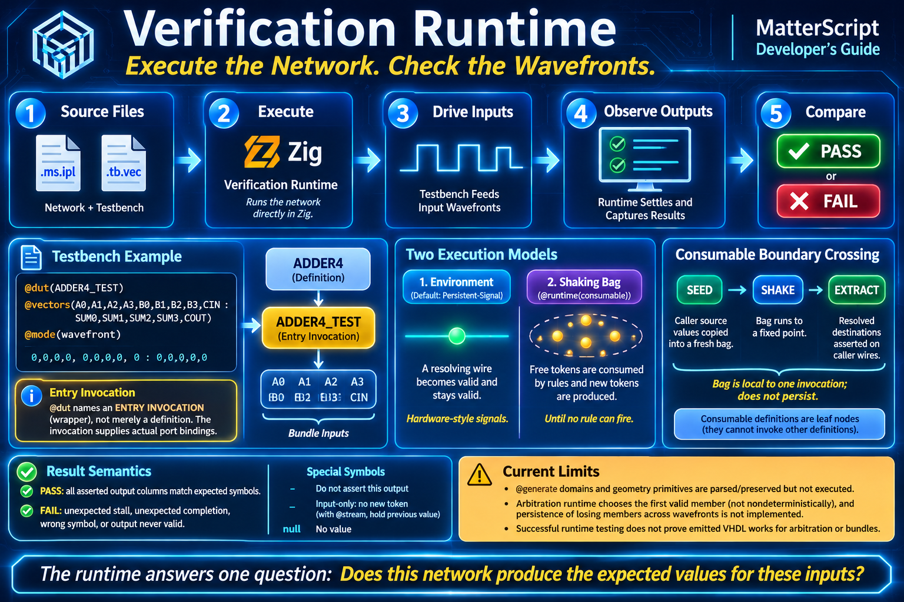

# Verification Runtime



The verification runtime executes a MatterScript network against a testbench file and reports pass/fail. It is the harness you use to check that a definition or entry produces the expected symbols for a given sequence of input wavefronts, before any VHDL is generated or simulated.

The runtime is **not** the emitter. It executes the parsed network directly in a Zig program. GHDL simulation and the VHDL it produces are a separate verification step; the runtime answers "does this network compute the right values?" without requiring a VHDL toolchain.

---

## Testbench File Format

A testbench file (`.tb.vec`) describes the inputs to feed and the outputs to expect. It pairs with an `.ms.ipl` file that defines the network.

```text
@dut(NAME)
@vectors(A0,A1,A2,A3,B0,B1,B2,B3,CIN : SUM0,SUM1,SUM2,SUM3,COUT)
@mode(wavefront)

0,0,0,0, 0,0,0,0, 0 : 0,0,0,0,0
1,0,0,0, 0,0,0,0, 0 : 1,0,0,0,0
```

### Directives

| Directive | Meaning |
|---|---|
| `@dut(NAME)` | The entry invocation to exercise. Must name an entry, not a definition alone (see [Entry Wrappers](#entry-wrappers)). |
| `@vectors(in : out)` | Column names for input and output wires, comma-separated. Names must match the entry invocation's ports. |
| `@mode(wavefront)` | One presentation per input row; the testbench feeds the row's inputs, waits for the DUT to settle, and observes the outputs. |
| `@mode(stall)` | The presentation is expected to stall (not complete); used to verify that a given input does **not** trigger the DUT. |
| `@stream()` | The vector is a stream across rows: a `_` in an input column means "this wire has no new token this wavefront; hold the previous value." |
| `@carry(in=out)` | When the input column `in` receives `_`, read the last observed value of output column `out`. Enables state-machine and feedback patterns. Requires `@stream()`. |

### Row notation

| Cell | Meaning |
|---|---|
| A token name (e.g. `K`, `S1`, `0`) | The wire carries this symbol on this row. |
| `null` | The wire carries no value on this row. |
| `_` | **Input only.** "No new token on this wire this row." Under `@stream()`, the wire holds its previous value. |
| `-` | **Output only.** Do not assert this column for this row. |

### Output comparison

Each row is compared against the expected outputs. A row passes if every non-`-` output column matches the value the DUT produced. A row fails if:

- The DUT stalled when a completion was expected.
- The DUT completed when a stall was expected (i.e. `!stall` row).
- A column produced the wrong symbol.
- A column never became valid.

---

## Execution Model

MatterScript supports two execution models for a definition:

- **Environment** (persistent-signal): the default. A wire becomes valid when a resolving rule fires and stays valid. Used for hardware-style signals.
- **Shaking bag** (`@runtime(consumable)`): a multiset of free tokens. Rules consume some tokens and produce others. The bag settles when no rule can fire.

The runtime dispatches on the definition's `@runtime` tag. There is no way to combine both models within a single definition; a definition is one or the other.

### Boundary crossings

When a non-consumable definition invokes a `@runtime(consumable)` callee, the runtime crosses the boundary:

1. **Seed**: the caller's values for the callee's source formals are copied into a fresh bag as free tokens.
2. **Shake**: the bag is run to a fixed point against the callee's consumable rules.
3. **Extract**: each destination the bag resolved (its "boundary assignment") is asserted on the caller's corresponding destination wire.

The bag is internal to the invocation. It does not persist across invocations, and its token set is not visible to the caller.

### Consumable callees are leaves

A `@runtime(consumable)` definition may not itself invoke other definitions. The runtime rejects a consumable definition containing an `.invoke` statement at parse time. To compose a bag-based definition with other logic, use the caller: invoke the consumable leaf and the other definitions side by side, and feed the leaf its inputs.

This is a deliberate limit. It keeps the bag model simple (bags don't nest) and the boundary in one place. If your design needs a bag to call something, the design is telling you to move that call to the caller.

---

## Entry Wrappers

A testbench's `@dut` names an **entry invocation**, not a definition. The entry invocation is the top-level statement that wires a definition to concrete ports:

```matterscript
MY_ENTRY($a $b)(result<>)
```

That's the thing `@dut` should refer to. An entry invocation for a definition called `MY_DEF` typically uses the same name or a `_TEST` suffix, depending on what the file looks like.

### Why entries, not definitions

A definition declares its interface: ports with names, group kinds, and directions. An invocation supplies the corresponding actuals: caller-scope wires, bundle expansions, arbitration groups. The invocation is where those bindings live. A testbench that names a definition directly has no bindings — it works only when the definition's ports happen to coincide 1:1 with the vector's columns, which is not the general case.

Concretely:

- Definitions with **bundle formals** (`[A<> 0..3]`) need an invocation that supplies a bundle actual (`[$A0 $A1 $A2 $A3]`). A bare definition `@dut` has no way to express that binding.
- Definitions with **arbitration groups** in an invocation source need an invocation to hold the group. A definition alone can't.
- Every **emitted `_network` entity** corresponds to an entry invocation, not a definition. Testing the entry is testing what will actually be simulated.

### The wrapper pattern

For a definition that takes `(a<> b<>)(result<>)`, the wrapper is:

```matterscript
MY_DEF_TEST($a $b)(result<>)
MY_DEF_TEST[($a $b)(result<>)
  MY_DEF($a $b)(result<>)
  :
]
```

The wrapper's ports mirror the vector's columns. The wrapper's body invokes the real definition with the corresponding actuals. The vector's `@dut(MY_DEF_TEST)` refers to the wrapper, not the underlying definition.

### Entry wrappers for bundle-shaped definitions

When the definition's formals are bundles, the wrapper's formals are the scalar members, and the wrapper's body bundles them back:

```matterscript
ADDER4_TEST($A0 $A1 $A2 $A3 $B0 $B1 $B2 $B3 $CIN)(SUM0<> SUM1<> SUM2<> SUM3<> COUT<>)
ADDER4_TEST[($A0 $A1 $A2 $A3 $B0 $B1 $B2 $B3 $CIN)(SUM0<> SUM1<> SUM2<> SUM3<> COUT<>)
  ADDER4([$A0 $A1 $A2 $A3] [$B0 $B1 $B2 $B3] $CIN)([SUM0<> SUM1<> SUM2<> SUM3<>] COUT<>)
  :
]
```

The vector's columns are `A0,A1,A2,A3,B0,B1,B2,B3,CIN : SUM0,SUM1,SUM2,SUM3,COUT`, matching the wrapper's ports 1:1. The bundle expansion happens in the wrapper's body, where the language's bundle syntax expresses it directly.

This is why the wrapper requirement exists: bundles and arbitration are invocation-level concepts, and a definition alone has no invocation to hold them.

### Entry wrappers for arbitration-group definitions

If a definition is invoked with an arbitration group (`{{$p1 $p2}}`), the wrapper exposes the group members as its own ports:

```matterscript
ARBITER_TEST($place1 $place2)(next<>)
ARBITER_TEST[($place1 $place2)(next<>)
  Arbiter({{$place1 $place2}})(next<>)
  :
]
```

The vector's columns are `place1,place2 : next`. The arbitration is expressed at the invocation inside the wrapper, where the language syntax is available.

---

## Arbitration

`{{$a $b}}` in an invocation's source list declares an **arbitration group**: N caller-scope places competing to feed a single callee port.

- **Zero members valid**: the group carries no value; the callee's port stays unresolved.
- **One member valid**: that member's value is the group's value.
- **Multiple members valid**: the group's value is the first valid member in source order.

The runtime picks one winner per wavefront, consumes the winner's value into the callee's port, and advances every member's position in lockstep. If multiple members carry tokens on the same wavefront, only the first one's token reaches the callee; the others are consumed and not retried.

### Current limits

- **Nondeterministic selection** is not implemented. The winner is always the first valid member in source order.
- **Persistence across wavefronts** ("losers wait their turn") is not implemented in the vector model. Each vector row is one independent wavefront; a member that lost on row *N* does not get another chance on row *N+1* unless the vector explicitly feeds it again.

These limits are documented so users don't build on behavior that isn't guaranteed. When the persistence semantics are implemented, the vector format will gain a way to express "this member remains valid for the next wavefront," and the doc will grow a section on it.

---

## Diagnostics

Runtime errors are reported per row. Common messages and their causes:

| Message | Cause |
|---|---|
| `BAD TB: input column 'X' is not a source place of Y` | The vector declares an input column that the entry invocation doesn't provide. Add a port to the entry wrapper, or rename the column. |
| `BAD TB: output column 'X' is not a destination place of Y` | Same, for outputs. |
| `BAD TB: no matching entry invocation for @dut` | The named `@dut` has no entry invocation. Add an entry wrapper (see above). |
| `BAD TB: no matching definition for @dut` | The named `@dut` has no definition at all — likely a typo in the network. |
| `line N (label): stalled, the wavefront never completed` | The DUT never resolved all its destinations. Either the inputs are insufficient (a wire that should feed something is null), or the DUT's rules don't produce the expected values for this combination. |
| `line N (label): expected stall, but the wavefront completed` | A `!stall` row (`@mode(stall)` or equivalent) expected the DUT to leave destinations unresolved, but it resolved them. |
| `line N (label): COL got WANT, want GOT` | A destination produced the wrong symbol. |
| `line N (label): COL never valid` | A destination never became valid; the DUT stalled on it. |
| `line N (label): runtime error ValueKeyedInvocationNotSupported` | A rule references a wire that is neither a source port nor produced by any rule. Usually a binding error in the DUT or the entry wrapper. |
| `line N (label): runtime error ConflictingBoundaryAssignment` | Two rules in a consumable callee resolved the same destination to different symbols. The callee's rule table is contradictory for this input combination. |

---

## Limitations and Open Work

The runtime does **not** currently:

- **Execute `@generate` domains.** Geometry generation and neighborhood rules are parsed but not executed.
- **Execute geometry primitives** (`point`, `edge`, `loop`, `face`). They are preserved in the AST but not evaluated.
- **Emit VHDL for arbitration groups.** The VHDL emitter currently stubs arbitration inputs to `null_value` and does not instantiate an arbiter primitive. Testing an arbitration shape via the runtime does not imply the emitted VHDL works; that's a separate piece of work.
- **Emit VHDL for bundle wrappers.** The entry wrapper pattern runs in the runtime, but the emitted `_network` entity for a wrapper definition may not yet reflect the wrapper's port list. Same caveat.
- **Model persistent arbitration.** See [Arbitration](#arbitration) above.

---

## Example

A complete testbench for a 4-bit ripple-carry adder:

```matterscript
// The definition
ADDER4[([A<> 0..3] [B<> 0..3] CIN<>)([$SUM 0..3] $COUT)
  FULLADD($A.0 $B.0 $CIN)(SUM.0<> C1<>)
  FULLADD($A.1 $B.1 $C1)(SUM.1<> C2<>)
  FULLADD($A.2 $B.2 $C2)(SUM.2<> C3<>)
  FULLADD($A.3 $B.3 $C3)(SUM.3<> COUT<>)
  :
]

// The entry wrapper (bundles the scalar ports for the invocation)
ADDER4_TEST($A0 $A1 $A2 $A3 $B0 $B1 $B2 $B3 $CIN)(SUM0<> SUM1<> SUM2<> SUM3<> COUT<>)
ADDER4_TEST[($A0 $A1 $A2 $A3 $B0 $B1 $B2 $B3 $CIN)(SUM0<> SUM1<> SUM2<> SUM3<> COUT<>)
  ADDER4([$A0 $A1 $A2 $A3] [$B0 $B1 $B2 $B3] $CIN)([SUM0<> SUM1<> SUM2<> SUM3<>] COUT<>)
  :
]

// The entry invocation for the testbench
ADDER4_TEST($A0 $A1 $A2 $A3 $B0 $B1 $B2 $B3 $CIN)(SUM0<> SUM1<> SUM2<> SUM3<> COUT<>)
```

```text
@dut(ADDER4_TEST)
@vectors(A0,A1,A2,A3,B0,B1,B2,B3,CIN : SUM0,SUM1,SUM2,SUM3,COUT)
@mode(wavefront)

0,0,0,0, 0,0,0,0, 0 : 0,0,0,0,0
1,0,0,0, 0,0,0,0, 0 : 1,0,0,0,0
1,1,1,1, 1,1,1,1, 0 : 0,1,1,1,1
```

Row 1: 0 + 0 + 0 = 0, no carry.
Row 2: 1 + 0 + 0 = 1, no carry.
Row 3: 15 + 15 + 0 = 30, sum bits `1110`, carry 1.

Each row's input columns feed the wrapper's scalar ports; the wrapper bundles them for `ADDER4`; the four `FULLADD` instances resolve; the results are extracted to the wrapper's destination ports; the comparison checks each output column against the expected values.

---

## Where to Look in the Code

- `src/dialects/ipl/runtime/rules.zig` — rule extraction and environment execution (`buildRules`, `run`).
- `src/dialects/ipl/runtime/bag.zig` — the shaking bag.
- `src/dialects/ipl/runtime/environment.zig` — the persistent-signal environment.
- `src/dialects/ipl/runtime/testbench.zig` — the wavefront driver.
- `src/dialects/ipl/runtime/tb_vectors.zig` — the `.tb.vec` parser and row runner.

This is not a stable API; the internal modules are documented for contributors, not as user-facing interfaces.
